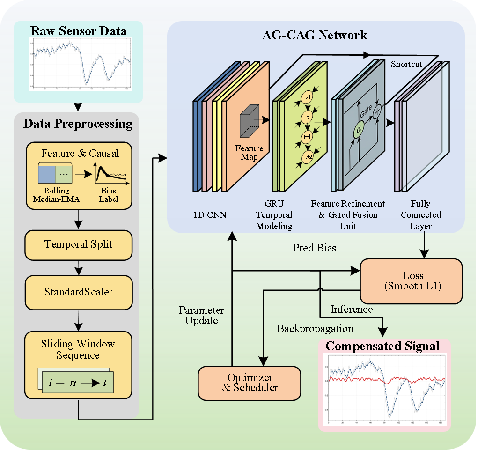

# FOG thermal-compensation metric audit

This public repository is a **limited algorithm example and evaluation package** for the associated IEEE TIM manuscript. It includes a stand-alone AG-CAG network example, metric-verification scripts, and synthetic tests. It does **not** include Data 1, Data 2, experimental measurements or predictions, trained weights, or the full training and acquisition pipeline.

<p align="center">
  
</p>

<p align="center"><em>Fig. 1. Causal preprocessing and AG-CAG architecture, reproduced from the revised manuscript.</em></p>

The reported target is a **sensor-derived operational zero-rate bias proxy**. Agreement with that proxy is not an independently calibrated absolute-bias measurement and does not demonstrate performance under nonzero rotation.

## What can be checked

- `agcag_example.py` shows the CNN, shared average/max channel attention, GRU, learned gate, and regression head. It runs on synthetic history windows; it is not a trained model or a reproduction of a paper result.
- `verify_metrics.py` recalculates RMSE, MAE, and R² for the six within-unit estimators on the same held-out rows of Data 1 or Data 2.
- `verify_transfer.py` recalculates per-axis, per-direction, and temperature-segment metrics from an approved pointwise cross-unit file. Directional summaries are arithmetic means of the three axis scores, not scores after pooling axes.
- The included CSVs are **synthetic software tests**, not evidence for any result in the paper. Experimental metrics can be recomputed only if the reader separately obtains authorized pointwise targets and predictions.

The file schemas and the boundary between numerical audit and full experimental reproduction are described in [EVALUATION_PROTOCOL.md](EVALUATION_PROTOCOL.md).

## Run the examples

Python 3.9 or later is sufficient for the metric scripts. The architecture example additionally requires PyTorch; see `requirements-model.txt`.

```text
python verify_metrics.py examples/synthetic_demo.csv
python verify_transfer.py examples/synthetic_transfer.csv
python -m unittest discover -s tests
```

After installing PyTorch, the network can be exercised without any experimental input:

```text
python agcag_example.py
```

If you are separately authorized to receive pointwise results, keep them **outside this repository** and pass their local path to the metric scripts. No Data 1 or Data 2 file should be committed here.

## Data access

Data 1 and Data 2 are not publicly downloadable. Researchers or reviewers wishing to check the reported results may contact the corresponding author at **qiao_huiting@hotmail.com** to request access to an approved de-identified verification package. Requests are handled individually and remain subject to confidentiality obligations and any required institutional authorization; access to raw records or protected hardware details is not implied or guaranteed.

## Release boundary

No raw gyroscope or temperature time series, hardware identifiers, device parameters, locations, dates, model checkpoints, or full training code are included. An authorized pointwise package, if provided separately, permits recomputation of the stated **proxy-based numerical comparisons**. It does not independently verify data acquisition, preprocessing from raw measurements, model training, uncertainty propagation, Allan-deviation results, or physical traceability of the protected hardware chain.

The repository is publicly viewable for methodological inspection and limited numerical audit. No software reuse license is supplied; public visibility should not be interpreted as permission to redistribute or incorporate the code into another project. The complete Git history has been checked for restricted records before release.
